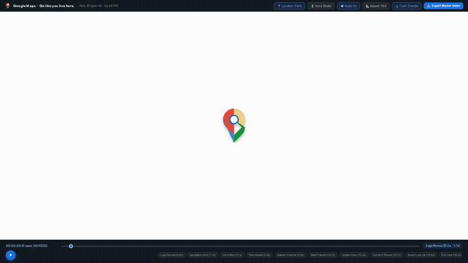
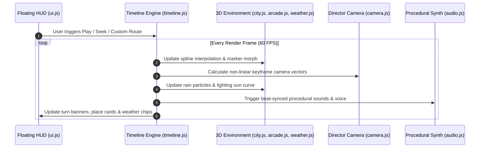

<div align="center">

# 🌍 GeoFlux - 3D Cinematic Google Maps Ad Generator

**A continuous, procedural 3D journey through global cities, built entirely in code.**

[](https://google-maps-3d-ad-generator.vercel.app)
[](https://threejs.org)
[](https://developer.mozilla.org/en-US/docs/Web/API/Web_Audio_API)
[](https://playwright.dev)
[](https://opensource.org/licenses/Apache-2.0)

<br/>

> 🚀 **LIVE PRODUCTION LINK**:  
> **[https://google-maps-3d-ad-generator.vercel.app](https://google-maps-3d-ad-generator.vercel.app)**  
> *(Experience interactive real-time 3D navigation, dynamic weather, custom city routing, and procedural audio directly in your browser)*

</div>

---

## 📽️ Cinematic Video Ad Showcase

<div align="center">



<br/>

### 🎥 Watch Full 1080p Master Ad with Procedural Audio
https://github.com/user-attachments/assets/demo-video

*(Direct repository media link: [`assets/geoflux_demo.mp4`](assets/geoflux_demo.mp4))*

<p align="center">
  <video src="https://github.com/hasim2006/GeoFlux/raw/main/assets/geoflux_demo.mp4" controls="controls" width="85%" poster="assets/bicycle.svg">
    Your browser does not support the video tag. <a href="assets/geoflux_demo.mp4">Download MP4 directly</a>.
  </video>
</p>

</div>

---

## 📖 About GeoFlux

**GeoFlux** is an open-source, code-generated 3D advertising and cinematic video engine designed around the official Google Maps spec concept:  
> *"Go like you live here. A continuous 3D journey through the city, built entirely in code."*

By combining **WebGL / Three.js**, the **Web Audio API**, **Google Maps Platform**, and **OpenStreetMap (Nominatim & OSRM)**, GeoFlux produces smooth 60 FPS promotional videos, commercial walkthroughs, and localized advertisements without requiring 3D modeling suites (Blender/Cinema4D) or external video editing software.

Everything — from Haussmannian facades, vaulted glass arcades, wet reflective roads, and dynamic golden hour sun physics to musical beats, acoustic room reverberations, and voiceover narrations — is computed in real-time.

---

## 🌟 Key Capabilities

### 1. 🏙️ Procedural 3D Environment Engine
- **Architectural Generation**: Haussmannian building blocks with Parisian zinc mansard roofs, classical limestone cornices, decorative iron balconies, glowing window matrices, and terracotta chimneys.
- **Hero Interior Arcade**: Galerie Vivienne covered passage featuring repeating neoclassical arches, glazed glass vaulted canopies, terrazzo mosaic floor runners, and illuminated oak boutique storefronts.
- **Landmark Horizons**: Procedural representations of the Eiffel Tower, India Gate, Empire State Building, Big Ben, Tokyo Tower, and Burj Khalifa.

### 2. 🗺️ Global Routing & Location Engine
- **Google Maps Integration**: Direct support for Google Maps Platform Javascript API & Directions service.
- **Free OpenStreetMap Engine**: Zero-API-key fallback using OSM Nominatim for forward/reverse geocoding and OSRM for realistic turn-by-turn driving, cycling, and walking splines.
- **Instant City Presets**: Pre-configured route topologies for **Paris, Delhi, New York, Tokyo, London, and Dubai**.

### 3. 🎵 Procedural Web Audio Synthesizer
- **Electronic Rhythm Track**: Steady 118 BPM forward rhythm driven by procedural dual-oscillator kicks, crisp filtered noise claps, and offbeat 16th-note hi-hats.
- **Spatial Audio Effects**:
  - Logo pop tick chime at `0.05s`
  - High-speed navigational whoosh sweep at `1.10s`
  - Bicycle mechanical freewheel ratchet clicks and brass handlebar bell at `3.10s`
  - Filtered brown noise rain generator and low-frequency rumble at `5.40s`
  - Acoustic convolution reverberation and warm minor-seventh chords inside Galerie Vivienne at `8.80s`
  - Sidewalk café chatter and arrival notification ping at `10.70s`

### 4. 🎙️ Voice Studio & Natural TTS
- Built-in speech synthesis engine capable of delivering crystal-clear location voiceovers.
- Adjustable speech rate, pitch, and voice profiles (US English, British, French, Natural Neural).
- Real-time preview and volume balancing alongside the synthesized music track.

### 5. ⛅ Dynamic Weather & Atmosphere
- **Atmospheric Scattering**: Smooth Three.js `ExponentialFog` transitions responding dynamically to route elevations.
- **Instanced Rain Physics**: 1,200 particle rain system featuring wind drift, angle velocity, and ground splash ripples.
- **Lighting Choreography**: Midday crisp sunlight transitioning to slate overcast rain ambience, moving into peach-orange Golden Hour sunset (`13.3s`), and culminating in deep luxury navy blue (`18.8s`).

### 6. 🎬 Dual Export Pipeline
- **In-Browser Recording**: Real-time 60 FPS recording via Canvas `captureStream()` and `MediaRecorder` directly into WebM or MP4.
- **Headless Offline Rendering**: Automated Python + Playwright headless Chromium pipeline for frame-accurate 1080p60 exports via FFmpeg.

---

## ⏱️ 22-Second Ad Progression (Beat Sheet)

```
0.0s ─── 1.1s ─── 3.1s ─── 5.4s ─── 8.8s ─── 10.7s ─── 13.3s ─── 16.7s ─── 18.8s ─── 20.3s ─── 22.0s
Logo     Nav      Get a    Rain     Galerie    Meet     Golden   Arrival  Brand    End
Reveal   Dive     Bike     Ahead    Vivienne   Friends  Hour     Reveal   Lockup   Card
```

| Beat | Timestamp | Scene Description | Sound & Audio Triggers |
| :---: | :---: | :--- | :--- |
| **01** | `0.0s – 1.1s` | **Logo Reveal**: White stage; Google Maps pin compresses into a pulsing blue radar dot. | Initial pop tick chime (`0.05s`), electronic rhythm kick. |
| **02** | `1.1s – 3.1s` | **Navigation Dive**: Low dive between Haussmann facades; green turn banner displays *"In 150m Rue de Rivoli"*. | High-speed navigation whoosh sweep (`1.10s`), dual confirmation chimes. |
| **03** | `3.1s – 5.4s` | **Get a Bike**: Vélib station card appears (★ 4.8, 14 bikes); GPS dot morphs into bicycle marker. | Freewheel mechanical ratchet clicks (`3.10s`), brass handlebar bell ring. |
| **04** | `5.4s – 8.8s` | **Rain Ahead**: *"Rain in 10 min"* weather chip; slate overcast lighting, falling rain streaks, asphalt gloss. | Filtered noise gentle rain loop (`5.40s`), distant ambient thunder rumble. |
| **05** | `8.8s – 10.7s` | **Galerie Vivienne**: Glide into glazed vaulted arcade with classical stone arches and mosaic floor. | Chamber room reverberation, warm minor-seventh chords (`8.80s`). |
| **06** | `10.7s – 13.3s` | **Meet Friends**: Daylight exit to Rue de Beaujolais café; *"3 friends already there"* avatar stack. | Sidewalk café chatter, arrival notification ping (`10.70s`). |
| **07** | `13.3s – 16.7s` | **Golden Hour**: Soaring aerial ascent above Tuileries; peach-orange sunset, Eiffel Tower silhouette. | Swelling synthesizer pads, filtered resonance sweeps. |
| **08** | `16.7s – 18.8s` | **Arrival / Reveal**: *"You have arrived"* banner; camera orbits terrace, pull-back to tilted floating map tile. | Full celebratory chord crescendo, rhythm resolution. |
| **09** | `18.8s – 20.3s` | **Brand Lock-Up**: City tile recedes into deep navy; pin in ethereal blue halo with *"Go like you live here."* | Pure sustained chord tail, decaying sub-bass pulse. |
| **10** | `20.3s – 22.0s` | **Creator End Card**: Blue focal point fade; creator signature `@leoreal.ai / hasim2006` with spec disclaimer. | Final sub-bass release into quiet decay. |

---

## 🏛️ System Architecture



---

## 📁 Repository Directory Structure

```
GeoFlux/
├── assets/                          # Static vector graphics & media assets
│   ├── geoflux_demo.mp4             # 1080p full demonstration video (1.07 MB)
│   ├── geoflux_preview.gif          # Optimized animated preview GIF (530 KB)
│   ├── bicycle.svg                  # Vector bike marker asset
│   ├── google_maps_pin.svg          # Official Google Maps 4-color pin
│   └── paris_map_data.json          # Pre-calculated Paris route waypoints & POIs
├── src/
│   ├── core/                        # Application coordinator & timeline engine
│   │   ├── main.js                  # Three.js bootstrap, render loop, event wiring
│   │   └── timeline.js              # 22-second mathematical beat-sheet driver
│   ├── graphics/                    # 3D Scene generation & visual effects
│   │   ├── city.js                  # Haussmann buildings, avenues, zinc roofs, trees
│   │   ├── arcade.js                # Galerie Vivienne vaulted glass canopy & mosaic
│   │   ├── route.js                 # Catmull-Rom spline, extruded tube & radar pulse
│   │   ├── weather.js               # Instanced rain particles, fog, golden hour lighting
│   │   └── camera.js                # Keyframed Director camera controller with physics
│   ├── audio/                       # Sound synthesis & speech engine
│   │   └── audio.js                 # 118 BPM Web Audio synthesizer & Voice Studio (TTS)
│   ├── maps/                        # Location & routing providers
│   │   └── mapsApi.js               # Google Maps Platform + OSM Nominatim & OSRM engine
│   ├── ui/                          # Floating UI overlays
│   │   └── ui.js                    # Turn banners, place cards, weather chips, HUD
│   └── export/                      # In-browser media export
│       └── recorder.js              # 60 FPS Canvas + Web Audio MP4/WebM recorder
├── scripts/                         # Automation & headless rendering
│   ├── render_video.py              # Offline 60 FPS headless 1080p renderer (Playwright)
│   ├── make_demo_video.py           # Demo video and GIF compilation pipeline
│   ├── generate_audio.py            # Standalone 22-second WAV master audio generator
│   └── tests/                       # Automated quality & visual regression tests
│       ├── test_beats.py            # Beat sheet integrity verification
│       └── test_render.py           # Headless browser zero-error runtime check
├── index.html                       # Application interface and responsive UI styling
├── package.json                     # NPM dependencies & Vite build script
├── vercel.json                      # Production HTTP security headers & rewrites
└── README.md                        # Documentation & project manual
```

---

## 🛠️ Technology Stack

| Domain | Technology | Purpose |
| :--- | :--- | :--- |
| **Frontend Framework** | Vanilla ES Modules / Vite 6 | High-speed, lightweight build with zero bundle bloat |
| **3D Rendering Engine** | [Three.js](https://threejs.org/) (r170) | WebGL 2.0 rendering, custom shaders, ACESFilmic tone mapping |
| **Procedural Audio** | Web Audio API | Real-time synthesis (Oscillators, BiquadFilters, Gain, Convolver) |
| **Voiceover Engine** | Web Speech Synthesis API | Procedural multilingual text-to-speech narration |
| **Geocoding & Routing** | Google Maps API & OSM / OSRM | Turn-by-turn coordinate resolution and spline generation |
| **Browser Recording** | Canvas `captureStream()` + MediaRecorder | Zero-install client-side 60 FPS video export |
| **Automated Testing** | [Playwright](https://playwright.dev/) + Python | Headless regression tests & frame-by-frame master export |
| **Cloud Hosting** | [Vercel](https://vercel.com/) | Edge-optimized deployment with strict HTTP security headers |

---

## 🚀 Quickstart & Local Setup

### Prerequisites
- [Node.js](https://nodejs.org/) (v18.0.0 or higher)
- [Python 3.10+](https://www.python.org/) *(Optional, for offline rendering pipeline)*

### 1. Clone & Install
```bash
# Clone the repository
git clone https://github.com/hasim2006/GeoFlux.git
cd GeoFlux

# Install dependencies
npm install
```

### 2. Start Local Development Server
```bash
npm run dev
```
Navigate to `http://localhost:5173` in Google Chrome or Microsoft Edge.

### 3. Build for Production
```bash
npm run build
npm run preview
```

---

## 🎥 Offline Master Rendering Pipeline (Python)

To generate a master 1080p60 uncompressed MP4 file offline using headless Chromium:

```bash
# 1. Install Python dependencies
pip install playwright imageio-ffmpeg
playwright install chromium

# 2. Render 22-second 60 FPS master ad
python scripts/render_video.py
```
The output file `Google_Maps_Go_Like_You_Live_Here_1080p60.mp4` will be rendered and multiplexed with `spec_audio.wav` automatically.

---

## 🔐 Security & Production Hardening

GeoFlux incorporates production-grade HTTP security headers configured in `vercel.json`:
- **`X-Content-Type-Options: nosniff`**: Prevents MIME-type sniffing.
- **`X-Frame-Options: SAMEORIGIN`**: Mitigates clickjacking attacks.
- **`Referrer-Policy: strict-origin-when-cross-origin`**: Guards referrer leaks.
- **`Cross-Origin-Opener-Policy: same-origin`**: Isolates browsing context.
- **`Cross-Origin-Embedder-Policy: credentialless`**: Allows secure cross-origin asset loading.
- **Runtime Key Isolation**: User Google Maps API keys are stored only in volatile browser memory and never committed or transmitted to third-party servers.

---

## 📄 License

This project is licensed under the **Apache License 2.0**. See the [LICENSE](LICENSE) file for details.

---

<div align="center">

Crafted with ❤️ by [**@hasim2006**](https://github.com/hasim2006)  
*Spec Ad Concept & Design inspired by official Google Maps Campaign guidelines.*

**[⬆ Back to Top](#-geoflux--3d-cinematic-google-maps-ad-generator)**

</div>
