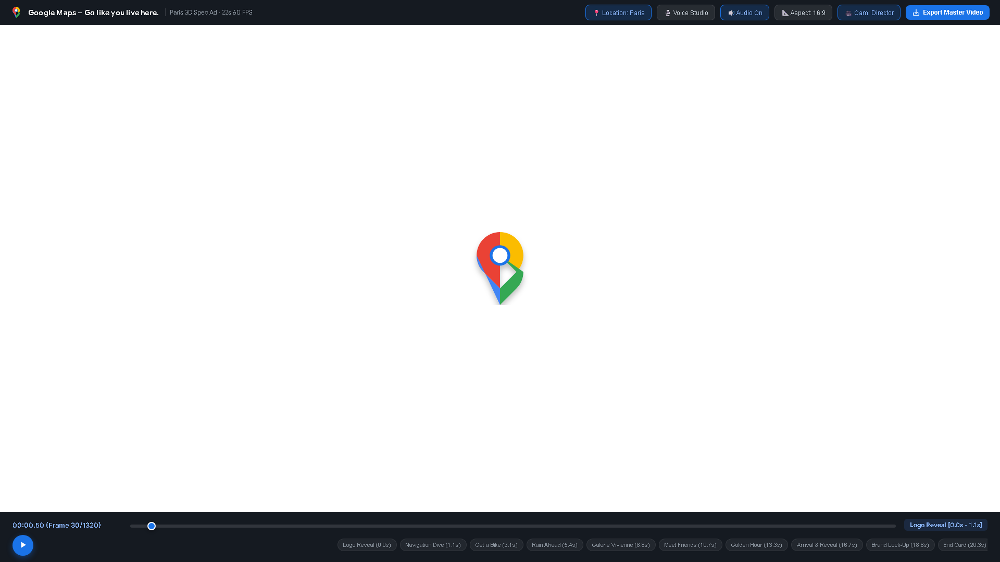
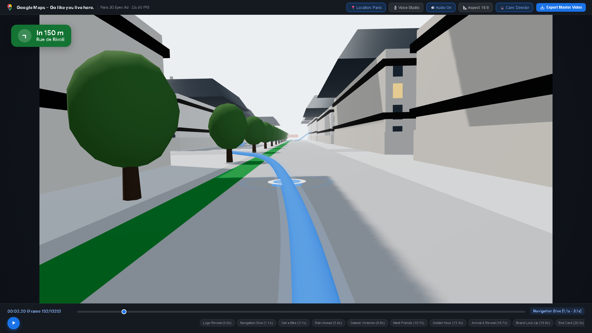
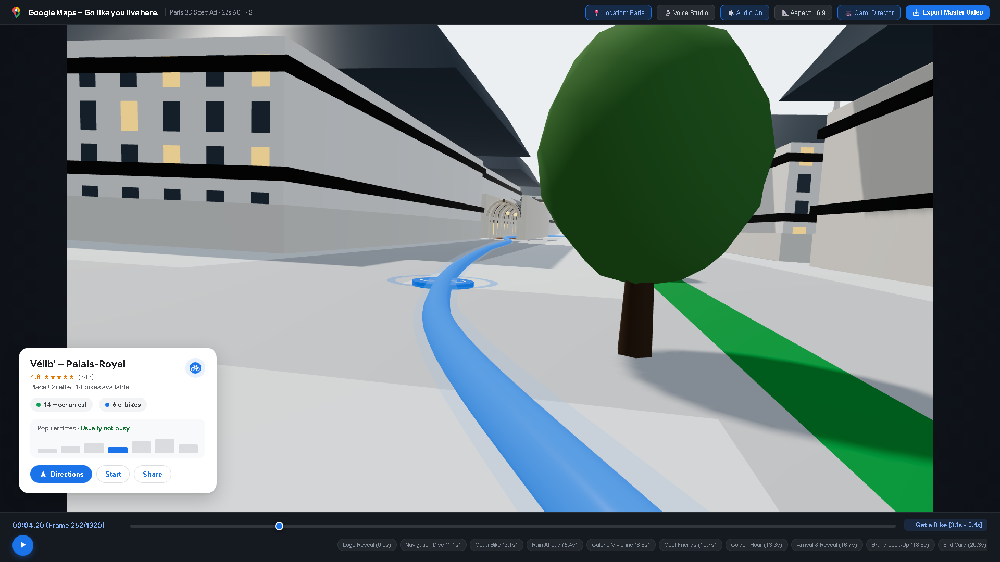
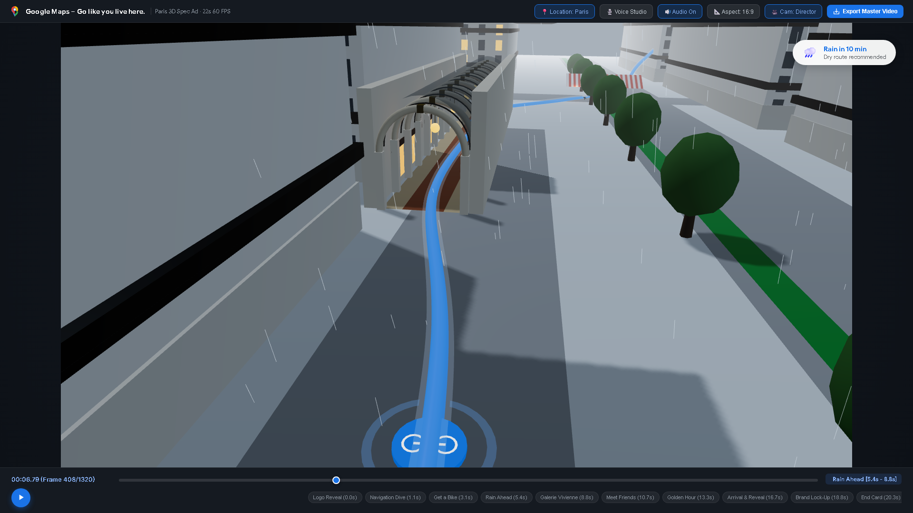
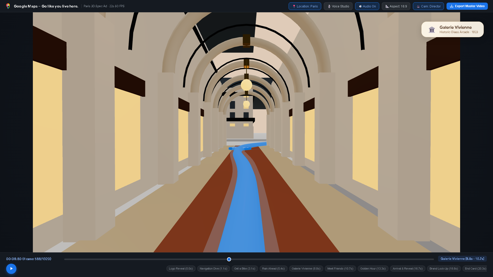
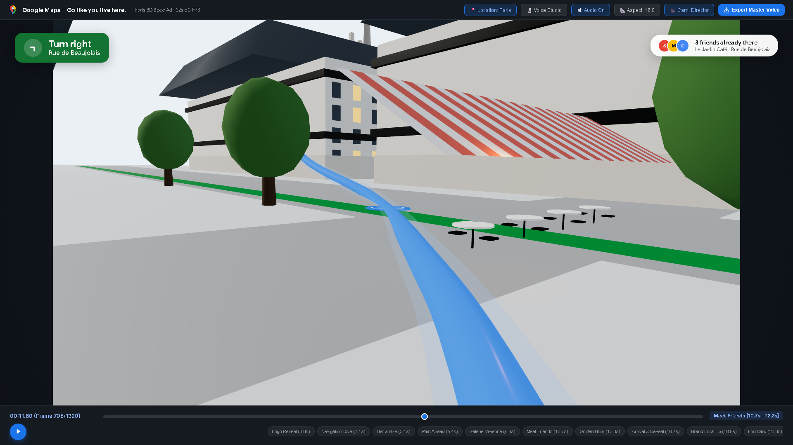
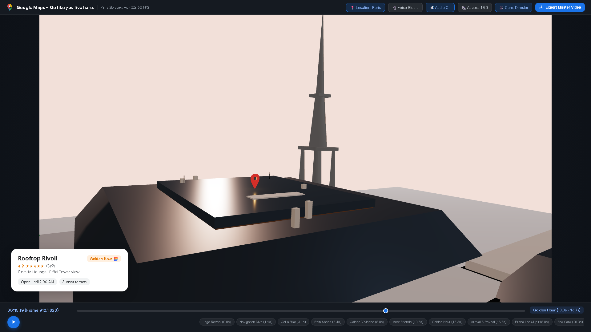
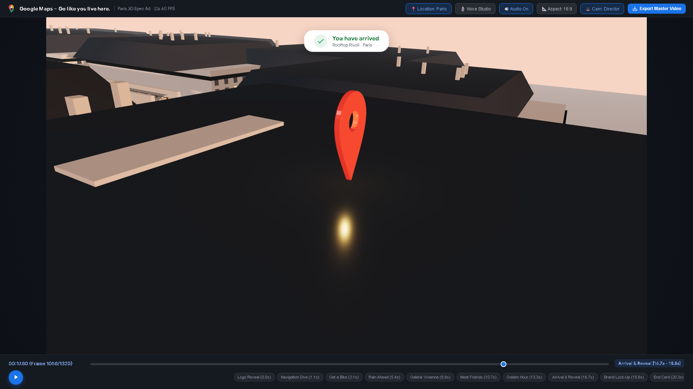
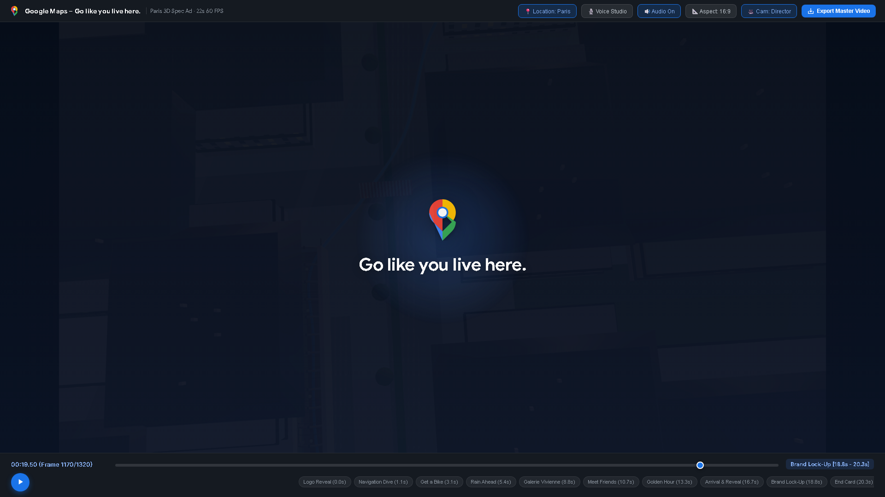
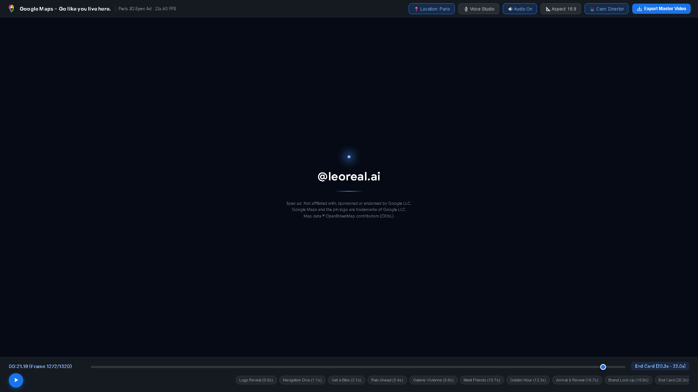

# 🌍 GeoFlux – 3D Google Maps Spec Ad & Cinematic Video Generator

[](https://google-maps-3d-ad-generator.vercel.app)
[](https://threejs.org)
[](https://developer.mozilla.org/en-US/docs/Web/API/Web_Audio_API)
[](https://playwright.dev)
[](https://opensource.org/licenses/Apache-2.0)

> **🚀 LIVE APPLICATION URL:**  
> **[https://google-maps-3d-ad-generator.vercel.app](https://google-maps-3d-ad-generator.vercel.app)**  
> *(Direct Deployment: [https://google-maps-3d-ad-generator-phlt90dwr-hasim2006s-projects.vercel.app](https://google-maps-3d-ad-generator-phlt90dwr-hasim2006s-projects.vercel.app))*

---

## 🎬 Video Showcase & Storyboard

**GeoFlux** is a code-generated 3D cinematic video ad engine built with **Three.js**, **Web Audio API**, and **Google Maps / OSM routing**, implementing the official spec ad concept:  
> *"Go like you live here. A continuous 3D journey through the city, built entirely in code."*

### 📸 Beat-by-Beat Visual Progression (22 Seconds)

| Beat | Timestamp | Scene Snapshot | Scene Highlights |
| :--- | :--- | :---: | :--- |
| **01. Logo Reveal** | `0.0s – 1.1s` |  | Multicolour Google Maps pin compresses into a pulsing blue GPS radar dot. |
| **02. Navigation Dive** | `1.1s – 3.1s` |  | Low dive between Haussmann facades; authentic green turn banner (*"In 150m Rue de Rivoli"*). |
| **03. Get a Bike** | `3.1s – 5.4s` |  | Vélib station place card (★ 4.8, 14 bikes, busy-hours graph); dot morphs into bicycle marker. |
| **04. Rain Ahead** | `5.4s – 8.8s` |  | *"Rain in 10 min"* chip appears; slate overcast lighting, falling rain streaks, reflective asphalt. |
| **05. Galerie Vivienne** | `8.8s – 10.7s` |  | Hero interior: Glazed vaulted glass canopy, repeating classical stone arches, mosaic floor. |
| **06. Meet Friends** | `10.7s – 13.3s` |  | Exit to daylight on Rue de Beaujolais; red-and-white café awning, 3 friends avatar chip. |
| **07. Golden Hour** | `13.3s – 16.7s` |  | Aerial rise above Tuileries park; peach-orange sunset, Eiffel Tower silhouette, Rooftop card. |
| **08. Arrival / Reveal** | `16.7s – 18.8s` |  | *"You have arrived"* banner; camera orbits terrace, pull-back to tilted floating map tile. |
| **09. Brand Lock-Up** | `18.8s – 20.3s` |  | City tile recedes into deep navy; pin in ethereal blue halo with *"Go like you live here."* |
| **10. Creator End Card** | `20.3s – 22.0s` |  | Fade to blue light point; creator signature `@leoreal.ai / hasim2006` with spec disclaimer. |

---

## ✨ Key Features

### 1. 📍 Dynamic Global Location Engine
- **One-Click Popular Presets**:
  - 🇫🇷 **Paris**: Rue de Rivoli ➔ Galerie Vivienne ➔ Rooftop Rivoli (*Eiffel Tower*)
  - 🇮🇳 **New Delhi**: Connaught Place Radial ➔ Janpath ➔ Imperial Rooftop (*India Gate*)
  - 🇺🇸 **New York**: Broadway ➔ Shubert Alley ➔ Manhattan Sky Lounge (*Empire State Building*)
  - 🇯🇵 **Tokyo**: Shibuya Crossing ➔ Cat Street ➔ Shibuya Sky Deck (*Tokyo Tower*)
  - 🇬🇧 **London**: Covent Garden ➔ Burlington Arcade ➔ Radio Rooftop (*Big Ben*)
  - 🇦🇪 **Dubai**: Downtown Blvd ➔ Souk Al Bahar ➔ CÉ LA VI Sky Lounge (*Burj Khalifa*)
- **Universal Custom Routing**:
  - Type any origin & destination (e.g., *"Marine Drive, Mumbai"* to *"Gateway of India"*).
  - Works with **Google Maps Platform API** or zero-setup **OpenStreetMap Nominatim + OSRM routing**.

### 2. 🎙️ Crystal-Clear Voice Studio
- **Natural Speech Synthesis**: Web Speech API integration with Google Natural, Premium UK/US English, and Microsoft clear voices.
- **Dynamic Script Adaptation**: Narration automatically personalizes to the active city and landmarks.
- **Audio Controls**: Fine-tune speech rate, pitch, and preview with the instant *"Test Clear Voice"* button.

### 3. 🎵 Procedural Web Audio Engine
- Built-in 118 BPM electronic forward rhythm track synthesized directly in code.
- Beat-synchronized sound design:
  - UI ticks, navigation whooshes, bicycle mechanical freewheel & bell.
  - Rain patter & soft thunder rumble.
  - Arcade room acoustic reverberation.
  - Social ping notifications & destination completion chime.
  - Signature harmonic Cmaj9 brand chord.

### 4. 📐 Multi-Format & Export Pipeline
- **16:9 Landscape (1920×1080)**: Master widescreen cinema presentation for YouTube/Web.
- **9:16 Vertical (1080×1920)**: Re-framed mobile format for Instagram Reels, TikTok, and YouTube Shorts.
- **In-Browser Export**: 1-click recording with Canvas `captureStream(60)` & Web Audio mixing.
- **Offline CLI Pipeline**: Playwright + FFmpeg headless 60 FPS deterministic frame-by-frame renderer.

---

## 🏛️ Domain Architecture

```text
GeoFlux/
├── index.html                   # HTML5 Studio Shell & Floating Google Maps HUD
├── package.json                 # Project dependencies & Vite scripts
├── vercel.json                  # Production Vercel deployment & security headers
├── assets/                      # Vector graphics & visual preview assets
│   ├── bicycle.svg              # Saturated bicycle navigation icon
│   ├── google_maps_pin.svg      # Official Google Maps multicolour vector pin
│   ├── paris_map_data.json      # Coordinate waypoints and POI metadata
│   └── preview/                 # High-resolution beat sheet snapshot frames
├── src/
│   ├── core/                    # Core Application Lifecycle & Timeline
│   │   ├── main.js              # Application bootstrapper, Three.js renderer, studio UI
│   │   └── timeline.js          # 22.00-second mathematical beat sheet controller
│   ├── graphics/                # 3D Scene & Environmental Graphics
│   │   ├── city.js              # Haussmann facades, streets, parks & landmarks
│   │   ├── arcade.js            # Galerie Vivienne hero interior (vaulted glass canopy)
│   │   ├── route.js             # Glowing extruded Google Blue route & morphing marker
│   │   ├── weather.js           # Dynamic lighting, rain particles & wet road sheen
│   │   └── camera.js            # Director spline camera tracking with turn banking
│   ├── audio/                   # Sound Design & Voiceover Engine
│   │   └── audio.js             # Web Audio synthesizer, procedural SFX & natural TTS
│   ├── maps/                    # Geocoding & Routing Services
│   │   └── mapsApi.js           # Google Maps & OpenStreetMap OSRM routing client
│   ├── ui/                      # Floating Vector HUD & Material Design 3 Components
│   │   └── ui.js                # Green turn banners, place cards, chips, brand lock-up
│   └── export/                  # Video Recording & Export Pipeline
│       └── recorder.js          # In-browser 60 FPS MediaRecorder exporter
└── scripts/                     # Offline Automation Scripts
    ├── render_video.py          # Playwright + FFmpeg headless 1080p60 frame renderer
    ├── generate_audio.py        # Standalone 22-second 16-bit WAV audio stem synthesizer
    └── tests/                   # Visual regression & beat verification tests
```

---

## 🚀 Quickstart Guide

### 1. Run Locally

```bash
# Clone the repository
git clone https://github.com/hasim2006/GeoFlux.git
cd GeoFlux

# Install dependencies
npm install

# Start development studio
npm run dev
```

Open your browser at `http://localhost:5173`.

### 2. Render Offline Video (Python + FFmpeg)

```bash
# Install Python prerequisites
pip install playwright imageio-ffmpeg pillow numpy
python -m playwright install chromium

# Render uncompressed 1080p 60fps master MP4
npm run render
```

---

## 📜 Attribution & Disclaimers

- Spec ad execution, not affiliated with, sponsored, or endorsed by Google LLC.
- Google, Google Maps, and the pin logo are trademarks of Google LLC.
- Map data © OpenStreetMap contributors (ODbL).
- Built with ❤️ by [@hasim2006](https://github.com/hasim2006).
